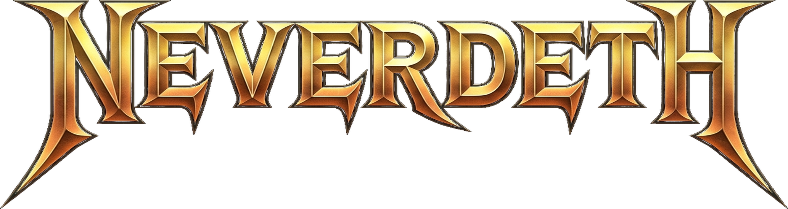

<div align="center">
  
  <p>
    <a href="README.md">English</a> | <b>Español</b>
  </p>
</div>

**Neverdeth** es un port nativo no oficial para Windows x64 de *NeverDead* (Xbox 360, 2012). Concebido como un **EmuComp** íntegramente asistido por IA (un enfoque híbrido que combina la recompilación estática de PowerPC a C++20 con un runtime propio de hardware de Xbox 360 y traducción sobre Direct3D 12), permite ejecutar el juego de forma nativa en Windows de 64 bits.

Este repositorio no contiene código original ni recursos propietarios del juego. Es necesario disponer de una copia propia de *NeverDead* para Xbox 360 (Title ID `4B4E081F`) para extraer los datos en el primer inicio.

## Características

- **Arquitectura EmuComp Nativa (x64 y Direct3D 12):** Combina recompilación estática del ejecutable con una capa ligera de runtime XDK/Xenos para correr de forma nativa sobre Windows x64 sin la sobrecarga de una máquina virtual completa.
- **Modo de Alto Framerate:** Funciona a los 30 FPS originales por defecto, con un modo opcional de framerate desbloqueado durante la acción 3D que mantiene los menús y cinemáticas a 30 FPS para preservar la sincronización del motor.
- **Menú Gráfico en Tiempo Real (`F10`):** Permite activar o desactivar en vivo sombras, SSAO, rayos volumétricos, niebla, bloom HDR, desenfoque de movimiento (motion blur), RMLAA y el HUD.
- **Instalador Integrado:** Extrae los datos del juego directamente desde imágenes `.iso` desencriptadas (XISO/XGD2), contenedores Games on Demand (`.data`) o carpetas extraídas al ejecutar el programa por primera vez.

## Requisitos del Sistema

- **Sistema Operativo:** Windows 10 (64 bits, versión 20H2 o superior) o Windows 11
- **GPU:** Tarjeta gráfica compatible con Direct3D 12 (NVIDIA GeForce serie GTX 900+, AMD Radeon serie RX 5000+ o Intel Arc)
- **Runtime:** [Microsoft Visual C++ 2015–2022 Redistributable (x64)](https://aka.ms/vs/17/release/vc_redist.x64.exe)
- **Control:** Mando compatible con XInput
- **Datos del Juego:** Copia original sin modificar de *NeverDead* para Xbox 360 (Title ID `4B4E081F`) en formato `.iso` desencriptado (XISO/XGD2), paquete Games on Demand (`.data`) o carpeta extraída que contenga `default.xex`

## Instalación y Uso

1. Descarga `Neverdeth-v0.1.0-alpha-win64.zip` desde la sección [Releases](https://github.com/Katzert/Neverdeth/releases) y descomprímelo en cualquier carpeta.
2. Ejecuta `Neverdeth.exe`.
3. En el asistente de primer inicio, selecciona tu imagen `.iso`, contenedor `.data` o carpeta del juego. Una vez finalizada la extracción en `assets/`, el juego arrancará automáticamente.

> **Nota:** Las imágenes `.iso` tipo Redump con cifrado físico de disco deben desencriptarse o convertirse a formato XISO estándar antes de importarlas.

## Configuración

Pulsa **F10** en cualquier momento durante la partida para abrir la ventana de ajustes, o edita manualmente el archivo `config/settings.ini`:

- **Framerate:** Activa `UnlockFramerate=true` (o márcalo desde el menú `F10`) para desbloquear los FPS durante el gameplay 3D.
- **Opciones Gráficas:** Los ajustes individuales de sombras, oclusión ambiental (SSAO), rayos de luz, niebla, bloom, motion blur, suavizado de bordes (RMLAA) y visibilidad del HUD se guardan automáticamente en `config/settings.ini`.

## Compilación desde el Código Fuente

### Requisitos de Compilación

- Visual Studio 2022 Build Tools y Windows 10/11 SDK
- Clang/LLVM 18+
- CMake 3.24+ y Ninja
- Python 3.10+

### Comandos de Compilación

```powershell
cmake --preset clang-release
ninja -C build_clang
```

Para generar el paquete distribuible en `dist/`:

```powershell
python tools/package_release.py
```

## Desarrollo Asistido por IA y Créditos

**Neverdeth** fue desarrollado como un proyecto **EmuComp** 100% asistido por inteligencia artificial, coordinando múltiples modelos a través de distintos entornos y herramientas para la ingeniería inversa, auditoría de bajo nivel y optimización en C++20/D3D12. Todo el desarrollo se llevó a cabo pagando únicamente la suscripción de **Google AI Pro**, sin gastar dinero adicional en las demás IAs gracias al reparto del flujo de trabajo entre modelos gratuitos distribuidos en varios programas:

- **Arquitectura Principal, Ingeniería Inversa y Auditoría (vía Google AI Pro):** Gemini Argon, Gemini 3.8 Flash
- **Análisis Adicional y Razonamiento de Código:** Claude Sonnet 4.5
- **Modelos Gratuitos (Distribuidos entre varias herramientas sin costo):** DeepSeek v4.1 Flash, GLM 5.3, GLM 5.3 Flash, Muse Spark 1.3, Nemotron 3.5 Super VL, MiniMax M3.1 Flash

### Toolchain y Agradecimientos

Desarrollado sobre el toolchain de recompilación estática [ReXGlue SDK](https://github.com/rexglue), apoyado en la documentación de hardware e investigación del proyecto [Xenia](https://xenia.jp/).

*NeverDead* fue desarrollado por Rebellion Developments y publicado por Konami Digital Entertainment. Este proyecto no tiene fines comerciales ni está afiliado ni respaldado por Konami Digital Entertainment ni Rebellion Developments.
