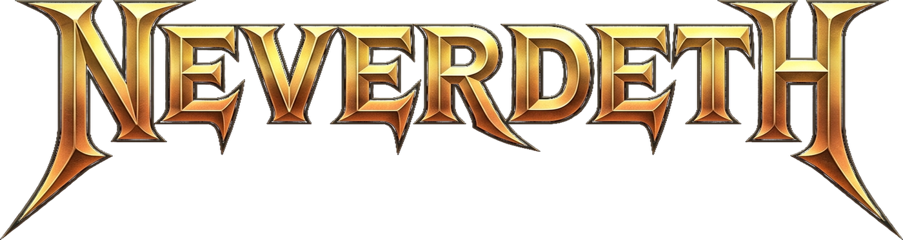
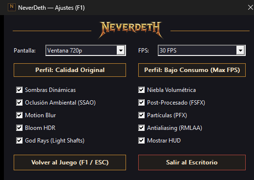

<p align="center"></p>

# NeverDead — Recompilación PC (ReXGlue) · Alpha v0.1.0

Recompilación estática del *NeverDead* de Xbox 360 a x64 nativo con el SDK
[ReXGlue](https://github.com/rexglue), usando el plugin GPU **Xenos → D3D12 con ROV**
(Rasterizer Ordered Views) para emular la eDRAM de 10 MB.

Proyecto de ingeniería inversa con fines de preservación y estudio.

## Estado

- Arranque, logos, menús y **gameplay 3D** estables.
- **Menú F1** (Dark Mode nativo, 520×320): perfil *Calidad Original* / *Bajo Consumo
  (Max FPS)*, 10 pases del renderer, límite de FPS y modo de ventana — todo en vivo.
- **F8** alterna 60/30 FPS. **F1 / ESC** abren y cierran el menú desde cualquier ventana.
- Benchmark de referencia (hospital, 720p): **101 FPS** todo ON · **142 FPS** con el
  perfil Bajo Consumo (16 flags OFF).

## Menú F1

<p align="center"></p>

Dark mode nativo, 520×370, botones owner-draw carbón/bronce y banner NEVERDETH.
Perfiles de un clic, 10 pases del renderer con lógica positiva y F1/ESC desde
cualquier ventana.

## Rendimiento y Referencia para PCs de Gama Baja (30 FPS por defecto)

El juego arranca **limitado a 30 FPS** en el pacer del host. El reloj interno del
invitado (`0x82B31FBC`) sigue siempre a `0.0f`: si se le escribe otro valor, el motor
Asura se queda esperando vblanks tras el tercer `[SWAP]`.

Medido en la escena del hospital (RTX 2060, límite 160 W), 15 s de muestreo con
`nvidia-smi` cada 500 ms:

| Caso | Configuración | GPU | Potencia | ms/frame | FPS (bucle invitado) |
|---|---|---|---|---|---|
| 1 | 30 FPS + Bajo Consumo (16 flags OFF) | **25,3 %** | **40,0 W** | 30,87 | 32,4 |
| 2 | 30 FPS + Calidad Original (todo ON) | **41,9 %** | **64,6 W** | 28,00 | 35,7 |
| 3 | Ilimitado + Calidad Original | **97,3 %** | **97,9 W** | 10,51 | 95,2 |

**Lectura:** el límite de 30 FPS baja la GPU del 97 % al 42 % con todo encendido
(−57 puntos) y ahorra ~33 W; con el perfil Bajo Consumo se queda en el 25 % y 40 W.
La columna FPS es el bucle del invitado; la presentación real la fija el pacer a 30.

Reproducible con `python tools/bench_gpu.py 1|2|3`.

## Requisitos

- Windows 10/11 x64, GPU con D3D12 y **ROV Tier 1+** (y *tiled resources* para el
  buffer de memoria compartida).
- LLVM/Clang + Ninja + CMake ≥ 3.25 y las *Build Tools* de MSVC 2022 (headers/libs).
- SDK **ReXGlue 0.10.0** (`REXSDK_DIR` o en `CMAKE_PREFIX_PATH`).
- **Tu propia copia del juego**: `NeverDead_base.bin` y `assets/` **no se distribuyen**.

## Compilar

```bat
build_ninja.bat
:: o bien
cmake --preset clang && ninja -C build_clang neverdead
```

### Parche obligatorio del SDK: `fpscr` / `ldmxcsr`

El codegen emite **34.754** llamadas `ctx.fpscr.enable/disableFlushMode()` (una por
instrucción VMX). En el SDK original cada transición escribe `MXCSR` (`ldmxcsr`), lo que
serializa el pipeline de la CPU miles de veces por frame.

Copia `patches/sdk/rex/ppc/context.h` sobre
`<SDK>/include/rex/ppc/context.h` **antes de compilar**. El parche:

- convierte las cuatro variantes `*FlushMode()` en **solo-bandera** (0 escrituras MXCSR),
- fija `FTZ|DAZ` en `setcsr()` e `InitHost()` (comportamiento VMX de Xenon),
- y el pin por hilo vive en `src/nd_import_diag.h` (`NdiPinFlushToZero`).

Verificado: `ldmxcsr` por unidad de traducción **283 → 0**.

## Jugar

```bat
JUGAR_NEVERDEAD.bat
```

Diagnóstico opcional: `set ND_DIAG=1` antes de lanzar (telemetría `[FRAME]`/`[SWAP]`
en `build_clang\logs\`). Sin esa variable el binario **no escribe nada** por frame.

## Mapa del proyecto

```
src/         capa de ports: imports xboxkrnl, present gate, menú F1, pacer, VEH
config/      hooks midasm / thunks / CRT mapping del codegen
patches/     parches del SDK que la build asume (fpscr)
docs/        informes de ingeniería, inventario de CVars, mapa del grafo
tools/       arnés de benchmark, extractores y scripts de análisis
generated/   [no incluido] árbol recompilado por el codegen
```

## Legal

*NeverDead* © Konami. Este repositorio **no contiene ni distribuye** ningún asset, binario
ni dato original del juego: solo la capa de recompilación, configuración y parches.
Úsalo únicamente con una copia legítima que poseas.
