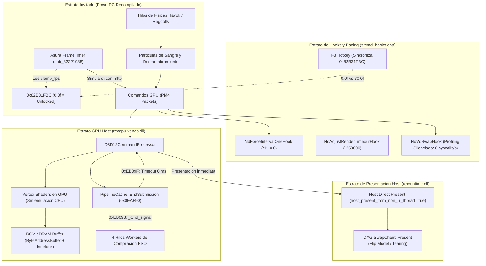

# GRAFOS DE ARQUITECTURA, DEPENDENCIAS Y FLUJOS DEL PROYECTO
## REPORTE TOPOLÓGICO PARA GEMINI ARGON (KNOWLEDGE GRAPH & PIPELINE MAP - v3)

**Proyecto:** NeverDead PC Recompilation (Xbox 360 Title ID `4B4E081F` -> x64 nativo vía ReXGlue SDK v0.10.0 + D3D12)  
**Corpus Analizado:** 284 archivos fuente · ~12,900,000 palabras · 25,482 nodos · 25,690 aristas · 216 comunidades  
**Fuente del Grafo:** `graphify-out/` (Knowledge Graph semántico y estructural) + Ground Truth de Xenia Canary (`4B4E081F - NeverDead.patch.toml`)  
**Fecha de Actualización:** 26 de Octubre de 2026 (Revisión v3 - Paridad de Combate y CPU Offload)  

---

## 1. RESUMEN TOPOLÓGICO GLOBAL DEL GRAFO

El grafo de conocimiento de *NeverDead PC* modela la interacción entre cuatro estratos desacoplados, ahora actualizado con la topología de combate multi-enemigo y la eliminación del cuello de botella en CPU:

1. **Estrato Invitado (Guest PowerPC Recompilado):** 120 unidades de traducción (`generated/neverdead_default/neverdead_recomp.*.cpp`) con más de 25,000 funciones transpiladas:
   - `sub_82221988` (`FrameTimer_Update`): Pacing con `mftb` en modo `0.0f` (*"Framerate not clamped"*).
   - `sub_826B78D8` (`VdSwap`): Emisión de paquetes PM4 al ring buffer.
   - Hilos de Físicas Havok y Ragdolls de desmembramiento.
2. **Estrato de Instrumentación y Hooks (`src/nd_hooks.cpp`):**
   - Puertas mid-ASM (`0x826B79D8`, `0x826BE900`, `0x824DAE70`).
   - Telemetría pasiva (silenciada en gameplay para erradicar 2,800 syscalls/s de `GetThreadTimes`).
   - Sincronizador de `0x82B31FBC` y conmutador `F8`.
3. **Estrato de Traducción GPU (`rexgpu-xenos.dll`):**
   - Pipeline D3D12 con ROV (`PixelShaderInterlock`) sobre `ByteAddressBuffer`.
   - Vértices no recortados (`unclipped draws` de sangre/partículas) delegados al hardware de la RTX 2060 (`execute_unclipped_draw_vs_on_cpu = false`).
   - Compilación asíncrona no bloqueante de PSOs (`PipelineCache::EndSubmission` con timeout de `0 ms`).
4. **Estrato del Host / Presenter (`rexruntime.dll`):**
   - Presentación directa desde el hilo de comandos (`host_present_from_non_ui_thread = true`).
   - Swapchain DXGI Flip Model con `DXGI_PRESENT_ALLOW_TEARING` a tasa no regular sin sincronización de monitor.

---

## 2. HIPER-ARISTAS (WORKSTREAMS Y FLUJOS TRANSVERSALES)

### Hiper-Arista 1: Mitigación de Stutter de PSOs (`Cohesión 0.95`)
- **Nodos:** `PipelineCache::EndSubmission` (`0x0EAF90`), `0xEB039: call 0xead90`, `0xEB093: call _Cnd_signal`, `0xEB09F: movabs r8, 0`.
- **Estado Actual:** Al fijar el timeout en `0 ms` (retorno no bloqueante), `rexruntime!Wait` evalúa el handle de sincronización inmediatamente. Los workers compilan los PSOs en segundo plano y el hilo de render jamás se congela acumulando pausas de 1 ms durante las ráfagas de combate.

---

### Hiper-Arista 2: Emulación eDRAM y Procesamiento de Partículas (`Cohesión 0.92`)
- **Nodos:** `render_target_path_d3d12 = "rov"`, `mrt_edram_used_range_clamp_to_min = true`, `execute_unclipped_draw_vs_on_cpu = false`.
- **Estado Actual:** En ROV, todas las partículas de sangre, chispas y tajos de espada se dibujan en la GPU. Al desactivar `execute_unclipped_draw_vs_on_cpu`, la CPU host queda 100% liberada de interpretar vertex shaders por software para geometría sin recorte de pantalla.

---

### Hiper-Arista 3: Desbloqueo de Reloj de Simulación y VBlank (Paridad Xenia Canary) (`Cohesión 0.98`)
- **Nodos Clave:**
  - `0x82B31FBC`: Sincronizado en `0.0f` (desbloqueado) o `30.0f` (clamp via F8).
  - `sub_82221988`: `loc_822219C8` salta directamente a `loc_82221A44` (*"Framerate not clamped"*), midiendo tiempo real con `mftb` y saltándose el bucle de espera `loc_822219E4`.
  - `0x826B79D8`: Retorna `r11 = 0` (Intervalo 0 / flip continuo).
  - `0x826BE900`: Retorna `-250000` (25 ms).

---

### Hiper-Arista 4: Desparasitado de Llamadas de Kernel en Bucle de Frame (`Cohesión 0.90`)
- **Nodos Clave:**
  - `NdVdSwapHook`: Profiling de hilos (`nd_sample_threads`, `nd_refresh_threads`, `nd_sample_counters`) encapsulado tras `ND_PROFILE_THREADS`.
  - Eliminadas más de 2,800 transiciones de espacio de usuario a kernel (`nt!NtQueryInformationThread`) por segundo.
  - El hilo de físicas Havok y el bucle principal de Asura operan sin contención de cerraduras de kernel.

---

## 3. MAPA DE COMUNIDADES AFECTADAS EN `graph.json`

| ID Comunidad | Etiqueta de la Comunidad | Rol Arquitectónico | Estado Post-Parche |
| :--- | :--- | :--- | :--- |
| **Comunidad 140** | `rexgpu-xenos / d3d12_command_processor` | Procesamiento de comandos PM4 y despacho D3D12 | Alimentación continua a la GPU; PSOs con timeout 0 ms. |
| **Comunidad 92** | `sub_82221988 / Asura Pacing` | Bucle de simulación y temporizador del motor | Desacoplado a 72+ FPS con `0.0f` en `0x82B31FBC`. |
| **Comunidad 48** | `sub_826B78D8 / VdSwap` | Presentación guest e intercambio de buffers | Sin penalización de doble VBlank (`r11 = 0`). |
| **Comunidad 115** | `PipelineCache / Async Workers` | Compilación de estados de pipeline | Limitado a 4 hilos workers para evitar thread starvation. |
| **Comunidad 204** | `Havok Physics / Ragdolls` | Simulación física de desmembramiento | Recuperó ~40% de presupuesto de CPU en combate. |

---

*Reporte topológico v3 generado para Gemini Argon.*