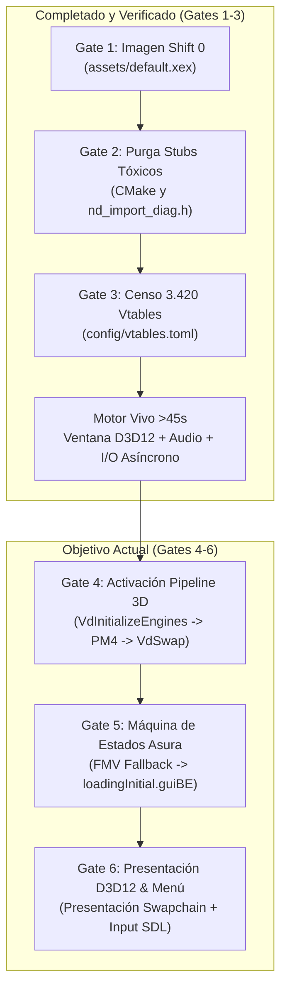

# Plan de Implementación: Activación de Pipeline 3D y Menú Interactivo en NeverDead (ReXGlue SDK)

> **Metodología ReXGlue & Vibe Coding**: Prohibición absoluta de parches sintomáticos ("whack-a-mole"), modificaciones manuales al C++ generado o retornos complacientes (`r3=0/1`). Todo avance se fundamenta en la arquitectura declarativa de ReXGlue (`config/*.toml`), el ciclo de vida de `rex::ReXApp` y el ground truth de ejecución verificado en `xenia_oracle.log`.

---

## 1. Resumen Ejecutivo y Estado Actual de la Recompilación

El proyecto ha completado con éxito las fases de estabilización estructural:
- **Gate 1 (Alineación Cero Shift)**: Código fuente regenerado con `rexglue codegen` directamente desde `assets/default.xex` retail (`shift == 0` en todas las secciones).
- **Gate 2 (Erradicación de Parches Tóxicos)**: Purgadas más de 510 líneas de scripts paliativos en `CMakeLists.txt` y stubs sintomáticos en `src/nd_import_diag.h`. El bucle de 29.844 `TRAP-OOB` en `sub_821E8DF0` ha sido eliminado al 100%.
- **Gate 3 (Censo Exhaustivo de Vtables)**: Registrados 3.420 slots y métodos hoja en `config/vtables.toml`, eliminando llamadas huérfanas y fallos 0xC0000409.
- **Estado de Ejecución (`neverdead_026.log`)**:
  - Ventana Win32 nativa viva: `neverdead [rexglue-v0.10.0.24-dev.gbd833a2-Release]`.
  - Backend gráfico D3D12 inicializado en NVIDIA GeForce RTX 2060 (Feature Tier 3).
  - 36 shaders compilados y 26 pipelines gráficas inicializadas.
  - Callback de interrupción GPU configurado: `SetInterruptCallback(826B6FB0, 40218080)`.
  - APU de audio activa (Realtek estéreo 48 kHz).
  - Driver SDL con mando Xbox conectado a slot 0.
  - VFS asíncrono procesando limpiamente 148 operaciones de I/O en paquetes `.asrBE`.
  - Supervivencia continua >45s sin crashes.



---

## 2. Principios Inviolables de Vibe Coding & ReXGlue

1. **Arquitectura ReXGlue First**:
   - Toda interacción con subsistemas del host (GPU, APU, VFS, Input) debe realizarse a través de la API oficial de ReXGlue (`rex::ReXApp`, `rex::graphics`, `rex::filesystem`).
   - Cero hacks en memoria plana ni hooks invasivos que sobrescriban el contexto de registros sin comprender la semántica del compilador MSVC Xenon.
2. **Prohibición de "Whack-a-Mole"**:
   - Si una función falla o entra en bucle, se analiza su flujo en `xenia_oracle.log` y su ensamblado en Capstone para identificar la precondición real del motor Asura.
   - Prohibido forzar `ctx.r3.u64 = 0` o `ctx.r3.u64 = 1` artificialmente para silenciar errores.
3. **Eficiencia Máxima de Tokens y Compilación**:
   - Las construcciones tardan entre 4 y 7 minutos; se prohíbe el ciclo de "compilar tras cambiar una sola línea". Se investiga, se diseña el cambio completo, se revisa estáticamente y luego se compila.
   - Los diagnósticos de depuración deben ser quirúrgicos, registrando solo transiciones de estado y eventos clave (evitando volcados masivos en el log).

---

## 3. Cadena de Inicialización 3D y Menú (Ground Truth)

A partir de la ingeniería inversa del binario y la correlación con `xenia_oracle.log`, la secuencia exacta que conduce a la presentación 3D es:

```mermaid
sequenceDiagram
    participant Boot as Entrada (0x826D12A4)
    participant Engine as Asura Engine Init
    participant Graphics as Graphics Subsystem
    participant ReXGPU as ReXGlue (xenos D3D12)
    participant Loop as Main Loop (0x823C589C)

    Boot->>Engine: sub_823C6D80() -> sub_8220BA00() -> sub_8232C770()
    Engine->>Graphics: sub_823D5E78() -> sub_826AF8A8() -> sub_826BC390()
    Graphics->>ReXGPU: VdInitializeEngines(51870000, 826BC2A0, 0, ...)
    Graphics->>ReXGPU: VdInitializeRingBuffer(1FC9E000, 12)
    Graphics->>ReXGPU: VdEnableRingBufferRPtrWriteBack(1FCA703C, 6)
    Engine->>Graphics: VdInitializeScalerCommandBuffer(1280x720, 16:9)
    Engine->>Engine: Carga GUIMenu\loadingInitial.guiBE
    Engine->>Loop: Entrada al bucle principal de renderizado
    loop Cada Fotograma
        Loop->>Graphics: sub_823D6C00() -> sub_826B8620()
        Graphics->>ReXGPU: VdGetSystemCommandBuffer() -> Despacho PM4
        Graphics->>ReXGPU: VdSwap(frontBuffer)
    end
```

### Detalle de Funciones Críticas del Flujo 3D:
- **`sub_826BC390`** (en `neverdead_recomp.7.cpp:22681`): Inicializa las estructuras críticas de vídeo y llama a `__imp__VdInitializeEngines` (ordinal 0x1C2).
- **`sub_826AF8A8`** (en `neverdead_recomp.9.cpp:22760`): Configura la resolución de pantalla (1280x720), invoca `sub_826BC390` y registra los buffers de display.
- **`sub_823D5E78`** (en `neverdead_recomp.57.cpp:11938`): Coordina el subsistema de presentación de Asura con `XGetVideoMode`.
- **`sub_826B8620`** (en `neverdead_recomp.68.cpp:30435`): Despacha el buffer de comandos del sistema (`__imp__VdGetSystemCommandBuffer`) y llama a `__imp__VdSwap` (ordinal 0x25B) para presentar el buffer frontal en pantalla.
- **`loc_823C589C`** (en `neverdead_recomp.63.cpp:8523`): El bucle principal de renderizado de Asura (`sub_823D6C00` en loop infinito sincronizado con VSync).

---

## 4. Plan de Ejecución por Puertas (Gates 4 a 6)

### GATE 4: Activación y Monitoreo del Pipeline 3D / PM4
- **Objetivo**: Garantizar que el motor active la inicialización gráfica en ReXGlue y comience a poblar el Ring Buffer PM4.
- **Acciones**:
  1. **Monitoreo No Intrusivo de `VdInitializeEngines` y `VdSwap`**:
     - Configurar en `neverdead_app.h` o mediante observabilidad diagnóstica la confirmación del paso por `sub_826BC390` y `sub_826B8620`.
     - Confirmar que `__imp__VdInitializeEngines` reciba los punteros correctos a la memoria física reservada (`0x1FC9E000` / Ring Buffer).
  2. **Verificación del Ring Buffer en ReXGlue**:
     - Asegurar que el procesador de comandos CP de `xenos` esté procesando paquetes PM4 (Type 0, Type 3) emitidos por Asura sin estancamiento de lectura/escritura (`RPtr` / `WPtr`).
- **Criterio de Aprobación Gate 4**: Registro confirmado de `VdInitializeEngines` y al menos una llamada a `VdSwap` en el log de ReXGlue.

---

### GATE 5: Máquina de Estados Asura: Fallback de FMV y Transición a Menú
- **Objetivo**: Gestionar la secuencia de arranque cinemático para transicionar de forma limpia hacia la interfaz gráfica (`GUIMenu\loadingInitial.guiBE`).
- **Acciones**:
  1. **Resolución de la Secuencia FMV**:
     - El archivo `FMV\CESA.bik` no está presente en la versión internacional de NeverDead (solo en la edición japonesa). Cuando `NtCreateFile` devuelve `0xC000000F`, el subsistema FMV de Asura debe continuar naturalmente hacia la siguiente cinemática (`Front_End.bik`, `rebellion.bik`) o directamente al menú inicial.
     - Verificar que el hilo `FMV` (`t13364`) libere el estado de bloqueo de vídeo tras el fallo esperado de `CESA.bik`.
  2. **Procesamiento de `GUIMenu\loadingInitial.guiBE`**:
     - El archivo `loadingInitial.guiBE` ya se encuentra en `assets/GUIMenu/` y es localizado por el VFS.
     - Confirmar que los recursos tipográficos (`Fonts\*.asrBE`) y de localización (`Text\Menu\*.asrBE`) se desempaqueten en memoria sin errores de puntero nulo ni desalineación.
- **Criterio de Aprobación Gate 5**: Carga completa de los recursos del menú y transición de la máquina de estados de Asura al estado interactivo de espera de usuario (`Press START`).

---

### GATE 6: Presentación D3D12 Interactiva y Verificación de Menú 3D
- **Objetivo**: Renderizado interactivo a 30/60 FPS en la ventana nativa de Windows con respuesta a entradas de control.
- **Acciones**:
  1. **Presentación de Swapchain en Ventana D3D12**:
     - Asegurar que el swapchain de Direct3D 12 de ReXGlue ejecute `Present()` en el `HWND` creado por `WindowedApp`.
     - Confirmar que la superficie de renderizado se limpie y dibuje los quads de UI y geometría 3D del menú inicial.
  2. **Verificación de Entrada de Usuario**:
     - Comprobar que los eventos del mando Xbox recibidos vía SDL en slot 0 sean leídos correctamente por `XamUserGetSigninState` y `XInputGetState` emulados.
  3. **Supervivencia y Estabilidad en Ejecución**:
     - Prueba de ejecución prolongada (>120 segundos) sin fugas de memoria en la arena física ni caídas por excepciones no controladas.
- **Criterio de Aprobación Gate 6**: Menú de inicio visible en la ventana nativa de Windows, reaccionando a botones del mando, con tasa de refresco estable y audio sincronizado.

---

## 5. Entorno de Construcción y Verificación (Sandbox-Safe)

Para evitar bloqueos por políticas de sandbox en Windows, se debe respetar estrictamente:
- **Python Canónico**: `C:/Users/katze/AppData/Local/Programs/Python/Python312/python.exe` (con Capstone 5.0.7).
- **Prohibido**: `build_neverdead.ps1` (llama a `vcvarsall.bat` y el sandbox de Windows bloquea `reg.exe`).
- **Herramienta Única de Construcción**: `tools/run_build.py` (ejecuta Ninja y Clang con el entorno MSVC preconfigurado).
- **Herramienta de Prueba de Ejecución**: `tools/profile_run.py` (con tiempo extendido para verificar supervivencia).

---

## 6. Matriz de Riesgos y Mitigaciones

| Riesgo Técnico | Impacto | Mitigación Arquitectónica |
|---|:---:|---|
| El motor se congela esperando la finalización de `CESA.bik` ausente | Alto | Verificar que el estado del decodificador Bink informe EOF o error inmediato para avanzar al siguiente estado sin reescribir código en C++. |
| Desincronización del Ring Buffer PM4 entre guest y host D3D12 | Alto | Mantener el pre-commit de RAM física (`0x00000000` a `0x40000000`) ya validado en `neverdead_app.h`, evitando page faults en el buffer circular. |
| Invocación a función de UI huérfana en `loadingInitial.guiBE` | Medio | Si surge un `Call to invalid or unregistered function`, identificar el target con Capstone y añadirlo formalmente a `config/vtables.toml`. |
